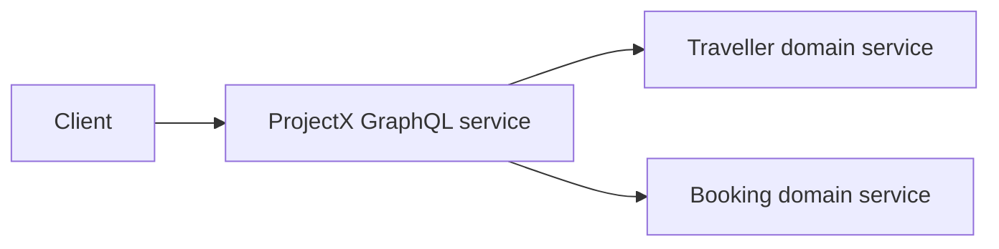

# CTO-writer — examples

All names, paths, links, and test gates below are illustrative. **ProjectX** is a custom GraphQL backend that composes **Traveller** and **Booking** domain APIs. Domain services retain business rules and data ownership.

## Bad vs good (intro)

**Bad:**
> In this comprehensive document we will explore the various multifaceted approaches that the team might consider leveraging in order to build a GraphQL wrapper around Traveller and Booking across the ProjectX platform ecosystem, taking into account numerous important factors.

**Good:**
> Gate the **ProjectX GraphQL service** rollout on schema compatibility, Traveller/Booking resolver contracts, and staging smoke tests. **Related:** [test plan](https://code.example.test/projectx/blob/main/docs/graphql-wrapper-test-plan.md)

---

## Bad vs good (scope)

**Bad (prose):**
> For the MVP we are planning to support reading travellers and bookings and looking up bookings for a traveller, and we should do something sensible when a service is unavailable. Creating or changing bookings will come later, shared response caching is also deferred, and live-service tests will happen separately from PR checks.

**Good (table):**

| Integration point | MVP | Test surface |
|-------------------|-----|--------------|
| Traveller and Booking reads | **In** | Resolver mapping + stubbed API contracts |
| `Traveller.bookings` composition | **In** | Request-scoped batching + contract tests |
| Downstream failures | **In** | Timeout + GraphQL nullability tests |
| Booking mutations | **Deferred** | Verify write operations are absent from the public schema |
| Shared response cache | **Deferred** | Verify no cross-request cache is introduced |
| Live-service integration | **Out** (PR lane) | Staging smoke tests before rollout |

---

## Bad vs good (code)

**Bad:** 40-line `pipeline.yaml` excerpt in the doc.

**Good:**

| Tier | Suite | Link |
|------|-------|------|
| P0 | Traveller/Booking resolver contracts | [traveller-bookings.test.mjs](https://code.example.test/projectx/blob/main/test/graphql/traveller-bookings.test.mjs) |

```bash
node --test test/graphql/traveller-bookings.test.mjs
```

---

## Service boundary (mermaid)



The wrapper owns the GraphQL schema and resolver composition, not copies of domain business rules or databases.

---

## Split pattern (parent + child)

**Parent (options doc)** — keep strategic:

```markdown
### Option 1 — Resolver and contract tests

Validate the schema and stubbed Traveller/Booking API contracts in CI. **Detail:** [Test plan](./graphql-wrapper-test-plan.md)

| Layer | Gate | Coverage |
|-------|------|----------|
| Schema checks | PR | Breaking schema changes |
| Resolver contracts | PR | Mapping, batching, failure paths |
| Live-service smoke | Staging | Auth propagation + deployed API contracts |
```

**Child (testing doc)** — owns inventory, P0–P3, file index.

---

## Exemplar docs (ProjectX)

| Doc | Use as template for |
|-----|---------------------|
| `docs/graphql-wrapper-test-plan.md` | Resolver inventory, contract coverage, CI gates |
| `docs/graphql-wrapper-options.md` | Thin wrapper vs orchestration layer, effort/fidelity matrix |
